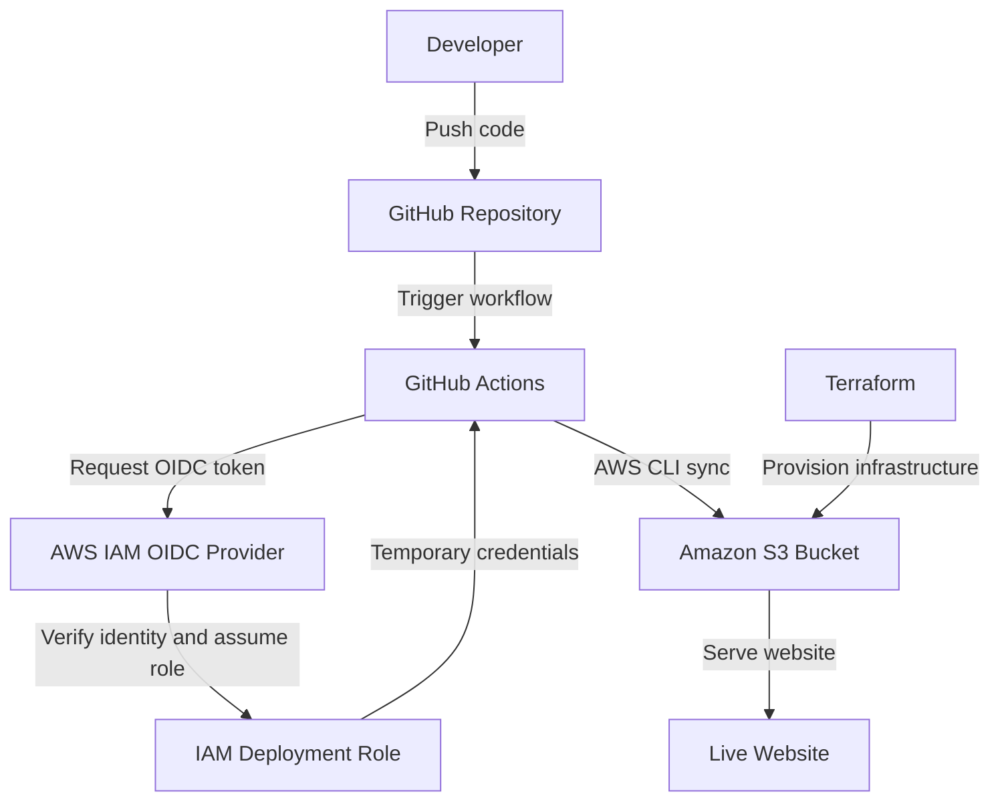

# Static Website Hosting on AWS using Terraform and GitHub Actions

## Project Overview

This project demonstrates how to host a static website on Amazon S3 using Terraform for Infrastructure as Code (IaC) and GitHub Actions for automated CI/CD deployment.

The deployment pipeline uses AWS IAM OpenID Connect (OIDC) authentication to securely connect GitHub Actions with AWS without storing long-term AWS access keys.

## Live Website

http://static-website-aws-798306367943.s3-website.ap-south-1.amazonaws.com

## Architecture



## Technologies Used

- Amazon S3 – Static website hosting
- AWS IAM – Identity and access management
- Terraform – Infrastructure provisioning
- Git and GitHub – Version control and source code management
- GitHub Actions – CI/CD automation
- AWS CLI – AWS resource management

## Project Features

- Automated S3 infrastructure provisioning using Terraform.
- Static website hosting on Amazon S3.
- Automated website deployment using GitHub Actions.
- Secure GitHub-to-AWS authentication using OIDC.
- IAM role with restricted S3 deployment permissions.
- Automatic website updates whenever changes are pushed to the main branch.

## Repository Structure

```text
static-website-aws/
│
├── .github/
│   └── workflows/
│       └── deploy.yml
│
├── terraform/
│   ├── main.tf
│   ├── variables.tf
│   ├── outputs.tf
│   ├── providers.tf
│   ├── versions.tf
│   └── terraform.tfvars.example
│
├── website/
│   ├── index.html
│   └── style.css
│
├── .gitignore
└── README.md
```

## CI/CD Workflow

1. Developer pushes website changes to the GitHub main branch.
2. GitHub Actions automatically starts the deployment workflow.
3. GitHub authenticates with AWS using OIDC.
4. AWS IAM verifies the GitHub identity and grants temporary credentials.
5. GitHub Actions uploads website files to the Amazon S3 bucket.
6. The updated website becomes available through the S3 website endpoint.

## Infrastructure Deployment

Terraform is used to manage the AWS infrastructure.

Initialize Terraform:

```bash
terraform init
```

Validate configuration:

```bash
terraform validate
```

Review infrastructure changes:

```bash
terraform plan
```

Apply infrastructure changes when approved:

```bash
terraform apply
```

## Automated Deployment

The GitHub Actions workflow is configured to deploy website files whenever changes are pushed to the main branch.

Workflow file:

`.github/workflows/deploy.yml`

## Security

- AWS authentication uses OpenID Connect (OIDC).
- No long-term AWS access keys are stored in GitHub.
- IAM permissions are restricted to the project S3 bucket.
- S3 encryption is configured using AES256.
- Terraform state files and sensitive variable files are excluded from Git.

## Important Note

This project uses Amazon S3 static website hosting. The website is publicly readable and uses HTTP rather than HTTPS. CloudFront is not included in the current deployment.

## Author

**Subhash P**

GitHub: https://github.com/subhashsmart24
